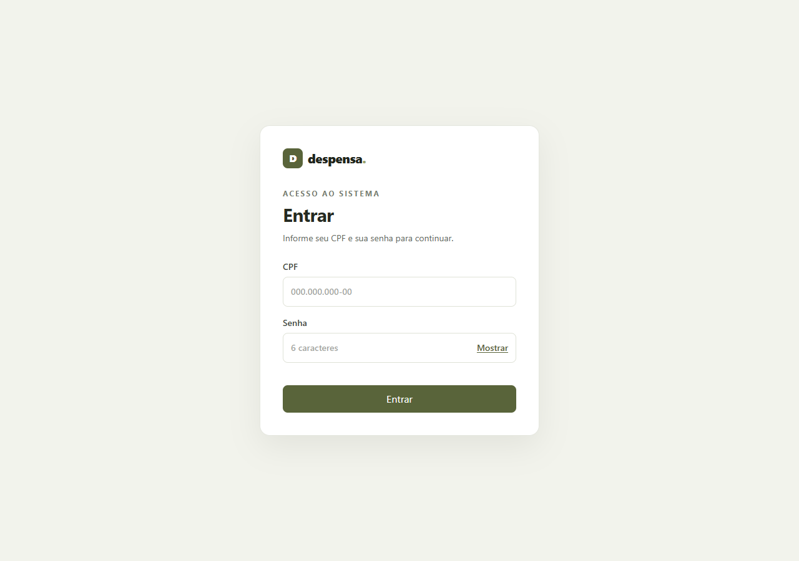
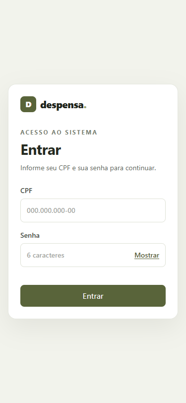
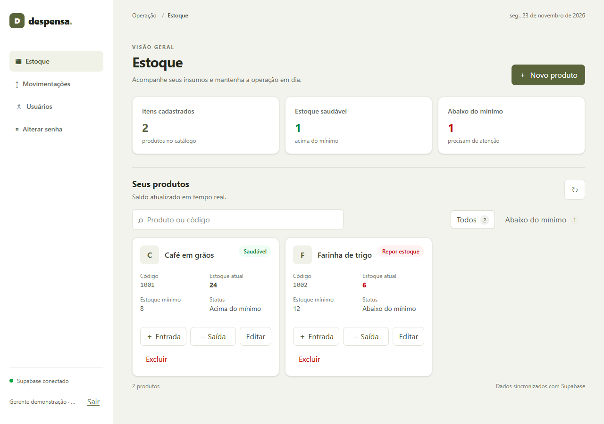
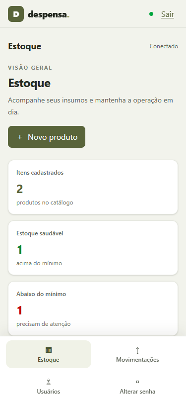
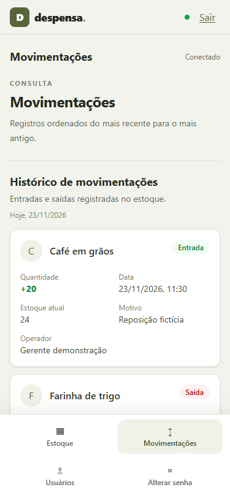
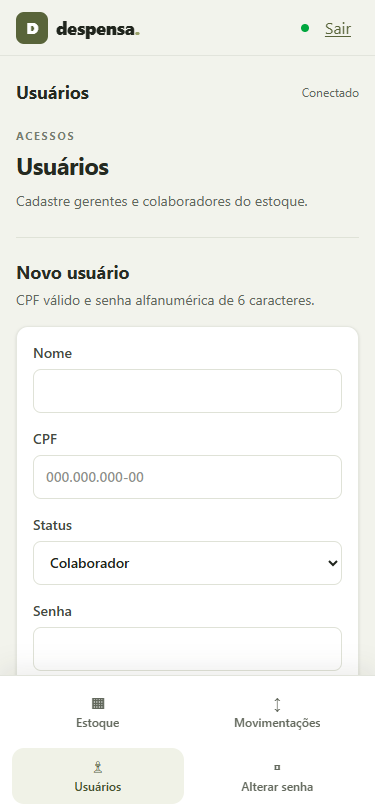
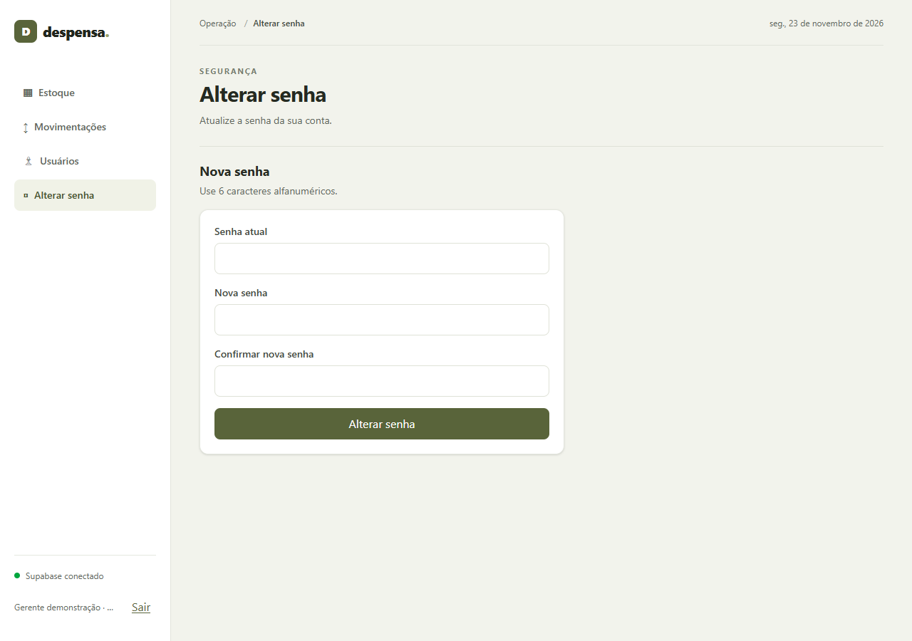

# Despensa | Controle de estoque

MVP responsivo de controle de estoque. A interface foi reescrita em React e Tailwind CSS; a API ASP.NET Core e o schema do Supabase permanecem como backend da aplicação.

## Telas

As capturas abaixo mostram a interface executada localmente com conteúdo demonstrativo fictício.

| Tela | Desktop | Mobile |
|---|---|---|
| Login |  |  |
| Estoque |  |  |
| Movimentações |  |  |
| Usuários |  |  |
| Alterar senha |  |  |
| Registrar entrada |  |  |
| Registrar saída |  |  |

## Requisitos

- .NET SDK 9.0 ou superior.
- Node.js 22.12 ou superior e npm.
- PowerShell 5.1 ou superior para cadastrar o primeiro gerente.
- Um projeto Supabase com acesso à chave secreta do backend.

## Instalação e execução

1. Para uma instalação vazia, crie o projeto Supabase, execute [`backend/supabase/schema.sql`](backend/supabase/schema.sql) no SQL Editor e, em seguida, aplique as migrações `003_movement_edit_and_delete.sql` e `004_fixes_and_hardening.sql`. O schema prepara as tabelas, índices, funções e triggers sem inserir usuários ou credenciais; as migrações instalam as operações transacionais de edição/exclusão e os ajustes de integridade. Para uma instalação existente, aplique em ordem os scripts incrementais `001`, `002`, `003` e `004` em [`backend/supabase/migrations/`](backend/supabase/migrations/).
2. Crie o arquivo local `.env` a partir do exemplo:

   ```powershell
   Copy-Item .env.example .env
   ```

   Preencha `SUPABASE_URL` e `SUPABASE_SECRET_KEY` no `.env`, ou configure essas variáveis no ambiente do processo. O script de inicialização aceita as duas formas e valida valores de exemplo/URL inválidos antes de iniciar. A chave secreta é usada somente no servidor e não deve ser compartilhada ou versionada. Também é aceita a variável legada `SUPABASE_SERVICE_ROLE_KEY`. As variáveis `TEST_USER_*` são opcionais e usadas apenas pelos exemplos em `users.http`; utilize dados fictícios.
3. Configure `INITIAL_MANAGER_NAME`, `INITIAL_MANAGER_CPF` e `INITIAL_MANAGER_PASSWORD` no `.env`, com os dados do gerente que você escolheu. O CPF deve ser válido e a senha deve conter 6 caracteres alfanuméricos. Cadastre o primeiro gerente uma única vez:

   ```powershell
   powershell -File .\backend\supabase\bootstrap-manager.ps1
   ```

   O script gera o hash PBKDF2 no computador local e grava o usuário no Supabase usando a chave de serviço; não imprime nem armazena a senha em outro local. Depois, remova as três variáveis de bootstrap do `.env`.
4. Compile a interface React para os arquivos estáticos servidos pela API:

   ```powershell
   Push-Location .\frontend
   npm ci
   npm run build
   Pop-Location
   ```
5. Inicie o MVP:

   ```powershell
   .\run-mvp.cmd
   ```

   Abra <http://localhost:5080>. Encerre o processo com `Ctrl+C`.

## Desenvolvimento da interface

Com as dependências instaladas e o `.env` configurado, inicie a API em um terminal e o servidor Vite em outro:

```powershell
.\backend\run-api.ps1
```

```powershell
Push-Location .\frontend
npm run dev
Pop-Location
```

Abra <http://localhost:5500>. O servidor Vite encaminha as chamadas de API para `http://localhost:5080`. Após alterações na interface, execute `npm run build` para atualizar os arquivos usados em produção.

## Diagnóstico de acesso ao banco

- `401/403` do Supabase: confira a chave secreta do projeto e não use `anon`/`publishable` no backend.
- `400/404`: em banco existente, execute as migrações `001` a `004` no projeto indicado por `SUPABASE_URL`; em instalação limpa, execute `schema.sql` e depois as migrações `003` e `004`.
- Falha de conexão sem status HTTP: confirme a URL HTTPS do projeto, a rede e se o projeto Supabase está ativo.
- A mensagem detalhada do Supabase fica nos logs do servidor; a resposta da API orienta a categoria do problema sem expor a chave.

## Recursos e comportamento

- Estoque, movimentações e usuários são apresentados em cards que mantêm as informações disponíveis nas telas. Produtos têm unidade de medida (1 a 10 caracteres; `"un"` é usada para cadastros antigos). Gerentes podem editar e excluir movimentações; o backend aplica a autorização e o banco recalcula saldos históricos na mesma transação, rejeitando alterações que deixariam qualquer saldo negativo.
- O histórico de movimentações continua incluindo produtos inativos. As operações de entrada, edição e exclusão bloqueiam a linha do produto durante a atualização do saldo para serializar alterações concorrentes.
- A tela Movimentações exige Data de Início e Data de Término. As datas devem ser escolhidas pelo calendário (entrada manual, colagem e arraste são bloqueados); ao sair de cada campo, a interface informa se o valor está ausente ou inválido. Ambos os campos aceitam somente o período inclusivo de 01/01/2000 a 31/12/2100. A consulta filtra datas inclusivas no fuso local do navegador e impede intervalo invertido tanto no formulário quanto na API.
- Entradas e saídas são registradas a partir dos cards de produtos.
- As telas de estoque, movimentações e usuários distinguem carregamento, lista vazia, erro com nova tentativa e dados carregados. Formulários mostram processamento, sucesso ou erro e impedem envios repetidos durante o processamento.
- Leituras da API são canceladas quando a tela ou diálogo é fechado, e abortos não são apresentados como erros de rede. Timeout e falhas de conexão exibem mensagens amigáveis; formulários mantêm os valores quando a gravação não foi concluída.
- O service worker usa Network-First para navegações e chamadas `/api/*`; respostas autenticadas não são guardadas no cache. O cache de navegação só é usado como fallback quando a rede falha.
- Os tokens de acesso são JWTs assinados com HMAC e sobrevivem à reinicialização da API por até 8 horas. Configure `Auth:SigningKey` (ou `Auth__SigningKey`) com uma chave aleatória de pelo menos 32 bytes; na ausência, a chave secreta do Supabase é usada como chave de assinatura. A interface não persiste o token e recarregar a página exige novo login.
- O catálogo e operações pendentes são separados por usuário em `despensa-products:{userId}` e `despensa-pending:{userId}`. O sincronizador usa mutex local e `navigator.locks` quando disponível; IDs de operações persistidos permitem repetição idempotente para cadastro de produto e movimentação. Nenhuma senha ou token é gravado no `localStorage`.
- Usuários e produtos são filtrados para ativos por padrão. Gerentes podem solicitar `includeInactive=true`; movimentações/saídas verificam o saldo na API e no trigger SQL.
- Tentativas de login são registradas em `login_audit`; o limite atômico é de cinco falhas por combinação CPF (hash) + IP a cada 15 minutos. O IP e user-agent são enviados somente à API.
- Em desenvolvimento, o Vite encaminha `/api` para `http://localhost:5080`; em produção, a API serve os assets React.
- A interface foi projetada para 375, 768 e 1280 px, sem rolagem horizontal.

## Build e Docker

Valide o backend com:

```powershell
dotnet build .\Estoque.slnx
```

Testes unitários disponíveis:

```powershell
Push-Location .\frontend
npm test
Pop-Location
```

Ainda não há suíte Playwright nem testes xUnit/WebApplicationFactory neste repositório. Os builds e os testes unitários de validadores/submissão não substituem teste de integração com PostgreSQL/Supabase.

Gere os arquivos estáticos do frontend antes de construir a imagem:

```powershell
Push-Location .\frontend
npm ci
npm run build
Pop-Location
docker build -t controle-estoque .
```

Configure as variáveis de ambiente do Supabase no serviço ou container. A imagem serve a API e o frontend na porta `8080` (ou na porta definida por `PORT`).

## Segurança e dados

O arquivo `.env` contém configurações locais e é ignorado pelo Git. O schema SQL não inclui nomes, CPFs, senhas nem contas iniciais; o gerente inicial é cadastrado explicitamente pelo script de bootstrap, usando variáveis locais. A chave de serviço do Supabase ignora RLS e deve permanecer exclusivamente no servidor.

Os tokens de autenticação são assinados e validados pela API, e os perfis permanecem verificados server-side. Configure uma chave HMAC forte, estável e compartilhada entre instâncias; sem ela, a chave secreta do Supabase é usada, e sua rotação encerra as sessões emitidas anteriormente. Use HTTPS em implantação pública.

## Respostas da Revisão Final

### Estados de UI observados no código

| Tela | Demora de 10 s | Falha de leitura/gravação | Array vazio |
|---|---|---|---|
| Login | Aviso global de demora; timeout em 15 s | Mensagem retornada pela API; 401 diferencia credenciais/usuário inativo | Não aplicável |
| Estoque | Aviso global; lista continua em carregamento | Erro da lista com retry; erro de gravação no formulário/toast | Exibe estado de catálogo vazio |
| Novo/editar produto | Aviso global | Erro de validação/API; retry da submissão | Não aplicável |
| Movimentações | Aviso global | Erro da lista com retry | Exibe histórico vazio |
| Usuários | Aviso global | Erro da lista com retry | Exibe cadastro vazio |
| Alterar senha | Aviso global; usuário carregado por `/api/me` | Erro de carregamento ou gravação | Não aplicável |
| Editar usuário | GET por ID independente ao abrir; aviso global | Erro no modal com retry | Não aplicável |
| Registrar entrada/saída | GET por ID independente ao abrir; aviso global | Erro no modal/form; saída acima do saldo é barrada | Não aplicável |

O aviso após 10 s e o timeout de 15 s estão no cliente comum de API; não há teste de atraso/timeout automatizado ainda. As telas não foram validadas com API mockada em estados completos.

### Validação por camada

| Regra | Frontend | Servidor | PostgreSQL |
|---|---|---|---|
| CPF | `isValidCpf` e feedback de formulário | Dígitos verificadores no cadastro/login | `is_valid_cpf` e CHECK do formato |
| Senha | Exatamente 6 caracteres ASCII alfanuméricos | Validação de contrato e PBKDF2 | Hash armazenado; não valida a senha em texto |
| Descrição e unidade | Valida limites após trim | Valida 3-250 e 1-10 caracteres e persiste valores trimados | CHECK de tamanho trimado; unidade padrão `un` |
| Quantidade e saldo | Decimal até 3 casas; saída limitada ao saldo exibido | Faixa `numeric(12,3)` e valida saldo lido | CHECK e trigger atômico bloqueiam saldo negativo |
| Usuário/produto ativo | Filtro padrão e filtro de inativos para gerente | Consultas por padrão filtram ativos; permissões por cargo | `is_active NOT NULL DEFAULT true`; trigger bloqueia movimento em produto inativo |

A redundância é intencional: o frontend melhora feedback, a API protege contra clientes não confiáveis e o banco é a autoridade final sob concorrência.

### Revisão crítica e verificação

- `useSubmission` impede execução concorrente no mesmo hook, preserva loading em `clear()` e oferece retry; há testes unitários para submissão dupla, retry e limpeza durante loading.
- O timeout e os eventos globais de aviso/401 são centralizados em `api.js`. A expiração é aplicada aos requests autenticados; sessões ainda são mantidas somente na memória do servidor.
- O cache/fila offline têm chaves por usuário, UUID para criação de produto/movimentação, verificação do proprietário local e trava por `navigator.locks` com fallback para mutex em memória. O banco tem índices únicos parciais e o repositório recupera o registro existente quando a resposta de uma operação idempotente foi perdida. Teste de duas abas/resposta perdida ainda não foi executado.
- O trigger de movimento atualiza saldo e `balance_after` na mesma transação e rejeita produto inativo ou saldo insuficiente. O CHECK impede saldos negativos.
- A proteção ao último gerente ativo usa advisory transaction lock e trigger `SECURITY DEFINER`; ainda não foi exercitada por teste concorrente contra PostgreSQL.
- `schema.sql` não contém comandos de truncamento ou remoção de coluna. A migração `001_preserve_product_code.sql` preserva os registros e valores de código existentes; a `002_active_audit_and_stock_integrity.sql` adiciona ativos, auditoria, idempotência e integridade de saldo.
- Verificado nesta revisão: `npm run build`, `npm test` e `dotnet build .\Estoque.slnx`. Não verificados: `dotnet test`, integração real com Supabase/PostgreSQL, Playwright nos viewports 375×812/768×1024/1280×800, ausência de rolagem horizontal e capturas mobile/tablet/desktop atualizadas.

### Itens ainda não atendidos

- `App.jsx` continua concentrando páginas e diálogos; somente `useSubmission` e os validadores foram extraídos. `useResource` e `useOfflineQueue` independentes ainda não existem.
- Button/Input/Card/Badge genéricos foram criados e usados em partes da interface, mas os elementos nativos restantes não foram todos substituídos.
- Ainda faltam testes de estado de cada tela com API mockada, teste de concorrência/resposta perdida da fila, xUnit com `WebApplicationFactory`/PostgreSQL e E2E Playwright. Portanto CRUD e controles de concorrência no banco ainda não estão comprovados por testes automatizados.
- Os prints versionados existentes não cobrem todas as telas/estados nem os três viewports exigidos; não foram gerados novos arquivos em `docs/prints/`.
- As migrações SQL foram revisadas estaticamente, mas não executadas: este ambiente não tem `psql` nem credenciais de banco de teste configuradas.
