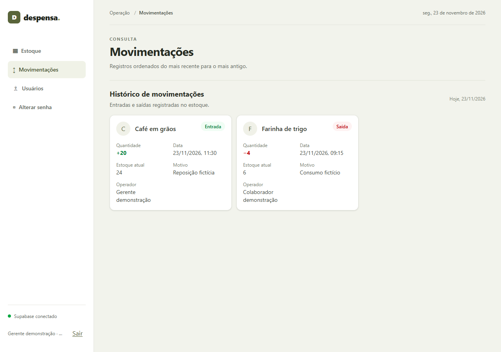
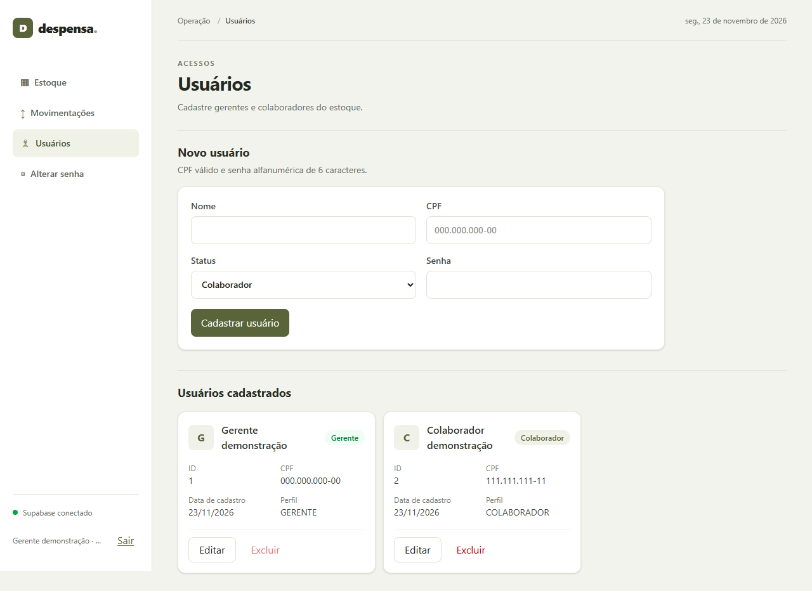
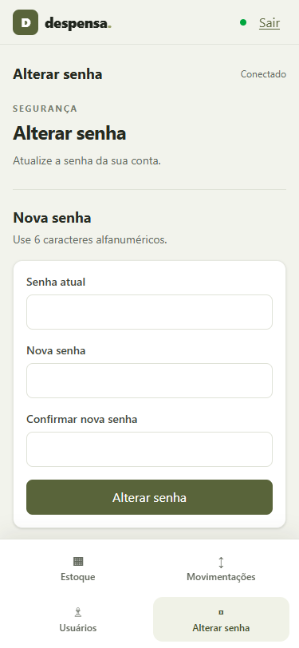
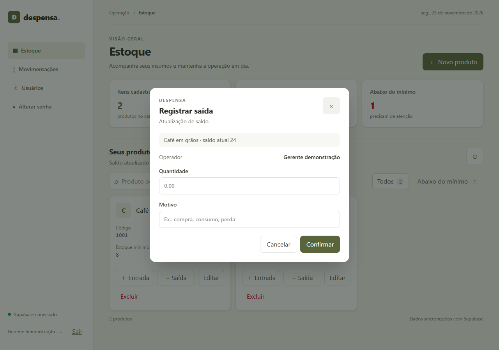
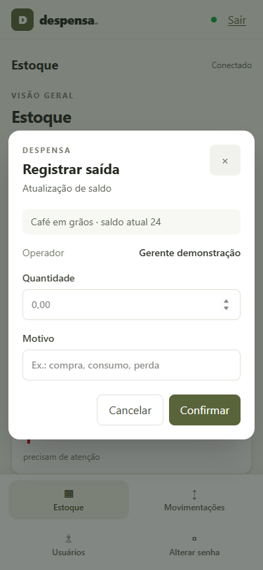

# Despensa | Controle de estoque

MVP responsivo de controle de estoque. A interface foi reescrita em React e Tailwind CSS; a API ASP.NET Core e o schema do Supabase permanecem como backend da aplicação.

## Telas

As capturas abaixo mostram a interface executada localmente com conteúdo demonstrativo fictício.

| Tela | Desktop | Mobile |
|---|---|---|
| Login |  |  |
| Estoque |  |  |
| Movimentações |  |  |
| Usuários |  |  |
| Alterar senha |  |  |
| Registrar entrada |  |  |
| Registrar saída |  |  |

## Requisitos

- .NET SDK 9.0 ou superior.
- Node.js 22.12 ou superior e npm.
- PowerShell 5.1 ou superior para cadastrar o primeiro gerente.
- Um projeto Supabase com acesso à chave secreta do backend.

## Instalação e execução

1. Crie o projeto Supabase e execute [`backend/supabase/schema.sql`](backend/supabase/schema.sql) no SQL Editor. O script prepara as tabelas, índices, políticas e trigger; não insere usuários ou credenciais.
2. Crie o arquivo local `.env` a partir do exemplo:

   ```powershell
   Copy-Item .env.example .env
   ```

   Preencha `SUPABASE_URL` e `SUPABASE_SECRET_KEY` no `.env`. A chave secreta é usada somente no servidor e não deve ser compartilhada ou versionada. Também é aceita a variável legada `SUPABASE_SERVICE_ROLE_KEY`. As variáveis `TEST_USER_*` são opcionais e usadas apenas pelos exemplos em `users.http`; utilize dados fictícios.
3. Configure `INITIAL_MANAGER_NAME`, `INITIAL_MANAGER_CPF` e `INITIAL_MANAGER_PASSWORD` no `.env`, com os dados do gerente que você escolheu. O CPF deve ser válido e a senha deve conter 6 caracteres alfanuméricos. Cadastre o primeiro gerente uma única vez:

   ```powershell
   powershell -File .\backend\supabase\bootstrap-manager.ps1
   ```

   O script gera o hash PBKDF2 no computador local e grava o usuário no Supabase usando a chave de serviço; não imprime nem armazena a senha em outro local. Depois, remova as três variáveis de bootstrap do `.env`.
4. Compile a interface React para os arquivos estáticos servidos pela API:

   ```powershell
   Push-Location .\frontend
   npm ci
   npm run build
   Pop-Location
   ```
5. Inicie o MVP:

   ```powershell
   .\run-mvp.cmd
   ```

   Abra <http://localhost:5080>. Encerre o processo com `Ctrl+C`.

## Desenvolvimento da interface

Com as dependências instaladas e o `.env` configurado, inicie a API em um terminal e o servidor Vite em outro:

```powershell
.\backend\run-api.ps1
```

```powershell
Push-Location .\frontend
npm run dev
Pop-Location
```

Abra <http://localhost:5500>. O servidor Vite encaminha as chamadas de API para `http://localhost:5080`. Após alterações na interface, execute `npm run build` para atualizar os arquivos usados em produção.

## Recursos e comportamento

- Estoque, movimentações e usuários são apresentados em cards que mantêm as informações disponíveis nas telas.
- Entradas e saídas são registradas a partir dos cards de produtos.
- As telas de estoque, movimentações e usuários distinguem carregamento, lista vazia, erro com nova tentativa e dados carregados. Formulários mostram processamento, sucesso ou erro e impedem envios repetidos durante o processamento.
- O token de acesso existe somente no estado em memória da aplicação; recarregar a página encerra a sessão.
- O catálogo e as operações offline pendentes podem ser mantidos localmente para sincronização. Nenhuma senha ou token de autenticação é armazenado no `localStorage`.
- A interface foi projetada para 375, 768 e 1280 px, sem rolagem horizontal.

## Build e Docker

Valide o backend com:

```powershell
dotnet build .\Estoque.slnx
```

Gere os arquivos estáticos do frontend antes de construir a imagem:

```powershell
Push-Location .\frontend
npm ci
npm run build
Pop-Location
docker build -t controle-estoque .
```

Configure as variáveis de ambiente do Supabase no serviço ou container. A imagem serve a API e o frontend na porta `8080` (ou na porta definida por `PORT`).

## Segurança e dados

O arquivo `.env` contém configurações locais e é ignorado pelo Git. O schema SQL não inclui nomes, CPFs, senhas nem contas iniciais; o gerente inicial é cadastrado explicitamente pelo script de bootstrap, usando variáveis locais. A chave de serviço do Supabase ignora RLS e deve permanecer exclusivamente no servidor.

Os tokens de autenticação e os perfis são validados pela API. A autenticação local não inclui limitação de tentativas nem fluxo de recuperação de senha; para implantação pública, use HTTPS e adicione controles operacionais apropriados.
